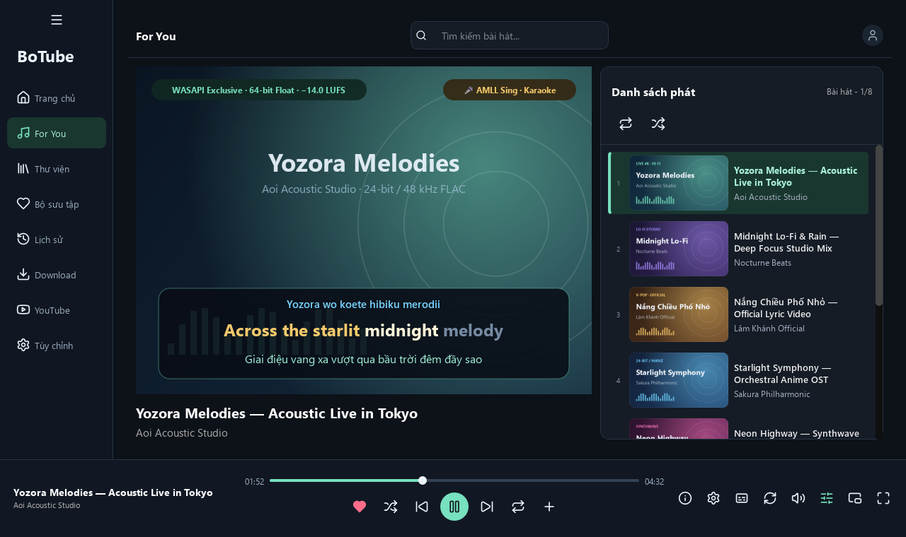
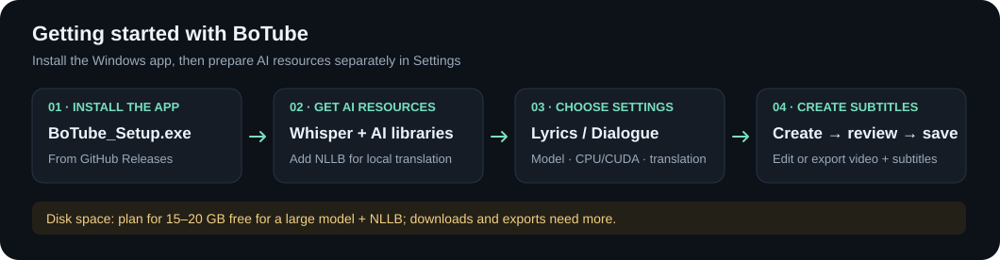

<div align="center">

# BoTube 6.0 · AI Media Player & Hi-Fi Audio Studio

**Next-Gen Windows AI Media Player — 64-bit Float WASAPI Exclusive Audio, Whisper CUDA ASR, Multi-LLM Lyric Translation, Word-Level Karaoke, NVIDIA NVENC Video Export & SHA-256 Auto-Updater**

<p>
  <a href="https://diablo-loc.github.io/App-AI-media-player/"></a>
  <a href="https://github.com/Diablo-Loc/App-AI-media-player/releases/latest/download/BoTube_Setup.exe"></a>
</p>

<p>
  <a href="https://github.com/Diablo-Loc/App-AI-media-player/releases/latest"></a>
  
  
  
  
  
</p>

[Tiếng Việt](README.md) · **English** · [🌐 Official BoTube 6.0 Website](https://diablo-loc.github.io/App-AI-media-player/) · [📦 Download BoTube_Setup.exe](https://github.com/Diablo-Loc/App-AI-media-player/releases/latest/download/BoTube_Setup.exe)

</div>

---

**BoTube 6.0** is a next-generation Windows 10/11 64-bit desktop media player engineered for audiophiles, music lovers, and creators. It unites a **64-bit Float Hi-Fi Audio Engine with WASAPI Exclusive DAC output**, **Faster-Whisper CUDA transcription**, **Multi-LLM lyric translation (NLLB / Gemini / OpenAI / Claude)**, **syllable-accurate Word Karaoke with instant offline phonetics**, **NVIDIA NVENC hardware video export**, and a **SHA-256 verified GitHub Releases auto-updater** inside one ultra-responsive, privacy-first application.



*This preview is rendered directly from the application's real PySide6 UI components with an empty playlist and contains no personal media data.*

---

## Major Highlights in BoTube 6.0

| Pillar | What's New in BoTube 6.0 |
| --- | --- |
| **64-bit Float Hi-Fi Audio & Audio Lab** | 64-bit Float DSP pipeline, **EBU R128 (−14 LUFS)** loudness normalization with 0 dBTP true-peak protection, **10-Band & Parametric EQ** (Squiglink/AutoEQ compatible), **WASAPI Exclusive** for external USB DACs, and an interactive RTA spectrum & live **A/B Audio Lab**. |
| **Word-Level Karaoke & Offline Phonetics** | Apple-Music-grade **AMLL Sing** sweep synced to true vocal syllable timings, plus instant offline romanization (**Hepburn Romaji, tone-marked Pinyin, Korean Revised Romanization**) toggled anytime with `R`. |
| **NVIDIA NVENC Video + Lyrics Export** | Automatic **NVIDIA GPU `h264_nvenc` ⚡** hardware acceleration for burning displayed lyrics and optical effects into 16:9, 9:16 Shorts, 1:1, or 4K video — with seamless CPU `libx264` fallback and lossless audio stream-copy. |
| **Collections, History & Smart Resume** | Dedicated **Collections** (Favorites, custom Playlists, Most Played statistics) and **Playback History** with timestamp-exact **Smart Resume**. |
| **Studio Settings & 100% Live VI/EN UI** | Redesigned auto-saving Studio Settings and instant **Vietnamese ↔ English** switching across every page, popup, chart, and dialog without restarting or touching saved user data. |
| **Auto-Updater & Lean Bundle** | Built-in **GitHub Releases + Inno Setup 6** updater with **SHA-256 verification**, UAC-safe silent in-place upgrades, automatic non-elevated relaunch, and a **>174 MB leaner** packaged footprint. |

---

## Complete Feature Set

- **Media Playback & Smart Library:** fast folder scanning (`.mp3`, `.mp4`, `.mkv`, `.wav`, `.mov`, `.avi`), instant metadata search, **For You** continuous queue, **Collections** (Favorites / Playlists / Most Played), **Smart Resume History**, fullscreen player, and **Mini Player**.
- **Hi-Fi Audio Studio:** remembered playback volume, non-destructive loudness balancing, dedicated DAC/headphone presets, 64-bit Parametric EQ, and real-time **Audio Lab** measurements.
- **Neural ASR & Fast Synced Lyrics:** prioritizes existing sidecar subtitles (`.lrc`/`.srt`/`.ass`) or verified **LRCLIB** vocal alignment (**< 1s**), automatically falling back to **Faster-Whisper** (`tiny` → `large-v3`, CPU or NVIDIA CUDA) in **Lyrics** or **Dialogue / Film** mode.
- **Multi-LLM Translation & Genius Verification:** free offline translation via **NLLB-200** or poetic online translation via **Google Gemini**, **OpenAI (GPT-4o / GPT-5)**, and **Anthropic Claude** with cue-verified **Genius** lyric cross-checking.
- **Kinetic Subtitles, Karaoke & Editor:** display Original, English, Vietnamese, or bilingual tracks; optional **AMLL Sing**, shuriken, star, petal, and kinetic typography presets; **🎤 Karaoke Mode**; offline top-line phonetics (`R`); plus a full subtitle editor supporting `JSON`, `SRT`, `ASS`, and `LRC`.
- **Video + Lyrics Burn-In Export:** flexible canvas framing (`source`, `16:9`, `9:16`, `1:1`, `4:5`, `21:9`), resolutions up to 4K, custom FPS, safe-area anti-clipping, and automatic **NVENC** acceleration.
- **Source-Quality Media Downloads:** powered by `yt-dlp`, preserving native AAC/Opus audio streams or MP3 320 kbps with resumable partial downloads.

---

## Installation & Upgrading (100% Safe 5.0 → 6.0 Upgrade)

### Fresh Install or Upgrade with `BoTube_Setup.exe`

**[🌐 Visit Official BoTube 6.0 Website](https://diablo-loc.github.io/App-AI-media-player/)** · **[⬇️ Download BoTube_Setup.exe](https://github.com/Diablo-Loc/App-AI-media-player/releases/latest/download/BoTube_Setup.exe)** · **[📋 All Releases](https://github.com/Diablo-Loc/App-AI-media-player/releases)**

1. Download **`BoTube_Setup.exe`** from [Releases](https://github.com/Diablo-Loc/App-AI-media-player/releases/latest) and run the Windows installer.
   - **Already running BoTube 5.0?** The 6.0 installer preserves the exact same `AppId`, upgrades in-place automatically, cleans up stale v5.0 runtime files, and **preserves 100% of your library, playlists, subtitles (`storage/`), and offline AI models (`app_resources/`)**.
2. Launch BoTube from the Start Menu or Desktop shortcut. Hi-Fi playback, downloads, and existing subtitles work immediately.
3. **Before generating AI subtitles for the first time**, open **Settings → Download / Manage Offline AI Models**, choose a Whisper model (`large-v3` recommended for multilingual music on NVIDIA GPUs), and click **Start automatic installation**.
4. For completely offline translation (or local fallback when cloud APIs fail), also install **Offline NLLB-200**.
5. Pick your compute device (`CUDA` or `CPU`), content mode, and preferred translation provider in **Settings** (changes auto-save immediately).



### Automatic In-App Updates (BoTube 6.0.0+)

BoTube 6.0 ships with a native **GitHub Releases Auto-Updater**:
- Performs a lightweight background check once per day on startup (configurable or triggerable manually anytime in **Settings → Software Updates**).
- Downloads `BoTube_Setup.exe` strictly over HTTPS from GitHub, validates the Windows PE header (`MZ`), and verifies the **SHA-256 cryptographic digest** before launch.
- Hands off cleanly to Inno Setup (`/SILENT /CLOSEAPPLICATIONS`), closes BoTube safely, upgrades binaries in-place, and automatically relaunches BoTube as a normal non-elevated user.
- Never touches your `storage/` directory or `app_resources/` AI models.

### Disk Space Guidance

**The installer size is not the total size after installing optional offline AI models:**
- `BoTube_Setup.exe` itself is lean and bundles only the app runtime, FFmpeg/FFprobe, and `yt-dlp`.
- Plan roughly **15–20 GB of free disk space** on the installation drive if you download a large Whisper model (`large-v3`), local `NLLB-200`, and PyTorch/CUDA libraries into `app_resources/`.
- Processed audio cache (`storage/audio-playback-cache/`) targets a ~**1 GiB** budget.

### Content Modes

| Mode | Best For | Processing Pipeline |
| --- | --- | --- |
| **Song Lyrics** · default | Music, MVs, lyric videos | Music-aware intro/credit guards, rhythmic cue grouping, word-level Karaoke timings, lyric translation prompts, and optional Genius verification. |
| **Dialogue / Film** | Movies, videos, podcasts | Natural pause/punctuation cue segmentation, bypasses music/Genius filters, and translates in natural dialogue style. |

---

## Keyboard Shortcuts

| Key | Action |
| --- | --- |
| `Space` | Play / Pause |
| `F` | Toggle Fullscreen |
| `Esc` | Exit Fullscreen |
| `←` / `→` | Seek Backward / Forward 10 seconds |
| `↑` / `↓` | Increase / Decrease Volume |
| `R` | Toggle top-line **Phonetics (Romaji / Pinyin / Korean)** during video playback |

---

## Running from Source & Building Releases

Target environment: **64-bit Windows 10/11, Python 3.11**. Place `ffmpeg.exe` and `ffprobe.exe` in `bin/` at the repository root (or `app_resources/bin/` / PATH).

### 1. Run from Source

```powershell
py -3.11 -m venv venv
.\venv\Scripts\python.exe -m pip install -r requirements.txt
.\venv\Scripts\python.exe app/run_app.py
```

### 2. Build Portable Package & Windows Installer (One Command)

Requires `PyInstaller` (`pip install -r requirements-build.txt`) and **Inno Setup 6**:

```powershell
# Builds PyInstaller portable bundle -> compiles Inno Setup 6 -> outputs BoTube_Setup.exe + .sha256
.\packaging\build_release_installer.ps1 -BuildPortable
```

- Automatically reads the single-source version from `app/version.py` (`6.0.2`), invokes `build_app.py` without overwriting previous `dist/` outputs, compiles `packaging/BoTube_Setup.iss`, and writes `Installer\BoTube_Setup.exe` alongside `Installer\BoTube_Setup.exe.sha256`.
- For a dry-run source & tooling check without compiling: `.\venv\Scripts\python.exe build_app.py --dry-run`.

### 3. User Data Layout

```text
BoTube/
├── BoTube.exe                    # Main executable
├── _internal/                    # PyInstaller runtime (cleanly replaced on upgrade)
├── bin/                          # FFmpeg, FFprobe
├── icon/ & resources/            # Application icons
├── app_resources/                # Portable AI libraries, Whisper & NLLB models (100% preserved)
└── storage/                      # Library, playlists, subtitles, preferences & cache (100% preserved)
```

---

## Development & Testing

Core source lives under `app/` (`core/`, `ui/`, `control/`, `ai/`, `pipeline/`, `translate/`, `subtitle/`, `download_core/`).

```powershell
$env:PYTHONPATH=".;app"; $env:KMP_DUPLICATE_LIB_OK="TRUE"; $env:QT_QPA_PLATFORM="offscreen"
.\venv\Scripts\python.exe -m unittest `
  tests.test_app_updater `
  tests.test_ui_settings_and_i18n `
  tests.test_app_optimization `
  tests.test_hifi_audio_engine `
  tests.test_subtitle_studio `
  tests.test_nvenc_video_export `
  tests.test_word_karaoke_and_phonetics `
  tests.test_playlists_favorites_history `
  tests.test_download_studio -v
```

See [project documentation](docs/README.md), [feature parity contracts](docs/FEATURE_PARITY.md), [testing guide](tests/README.md), and [development rules](AGENTS.md).

## Current Limitations

- Neural ASR may occasionally mishear words or drift timestamps on rapid vocals, heavy backing mixes, or overlapping dialogue — review cues in the built-in Subtitle Editor before publishing.
- Online translation and media downloads depend on network availability, API quotas, and upstream services; keep API keys and Genius tokens strictly local.
- Audio presets enhance loudness consistency and eliminate digital clipping, but cannot restore details permanently lost to low-bitrate source compression.

## Licenses & Third-Party Resources

- Bundled Lucide icons are licensed under the [ISC License](app/ui/assets/icons/LICENSE).
- The optional offline [NLLB-200 distilled 600M](https://huggingface.co/facebook/nllb-200-distilled-600M) model is distributed under **CC-BY-NC-4.0**; review its terms before commercial redistribution.
- Bundled third-party libraries, FFmpeg, `yt-dlp`, and AI models remain subject to their respective upstream licenses.
