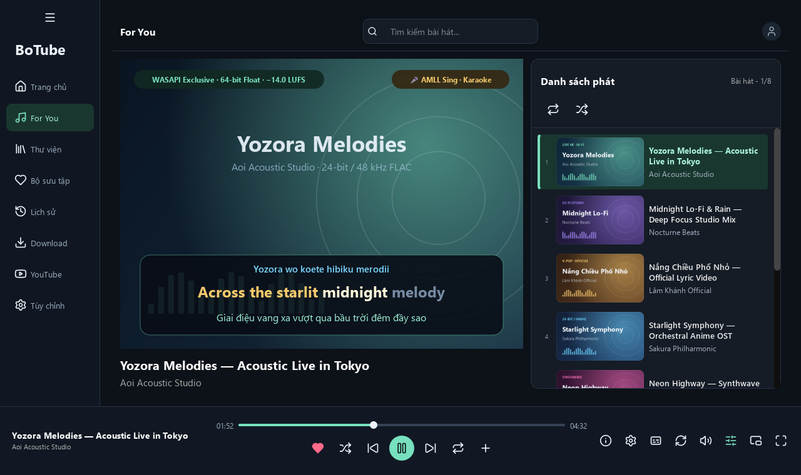
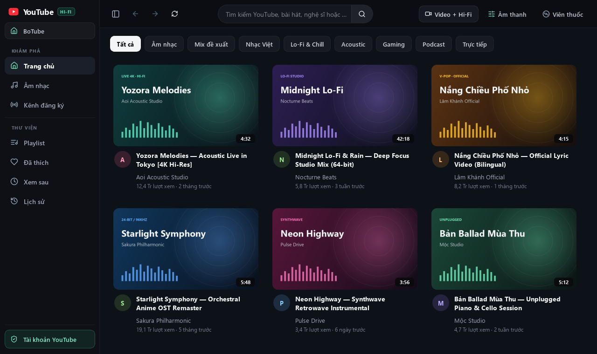
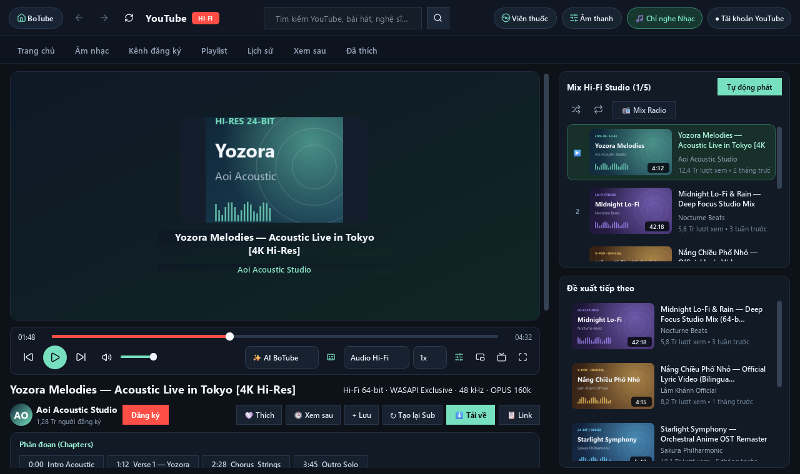
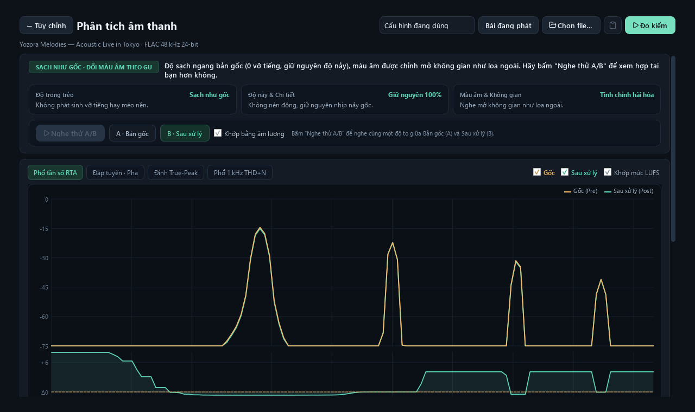
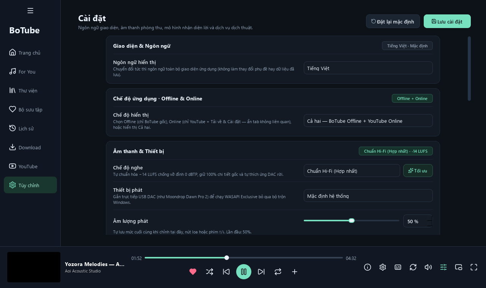
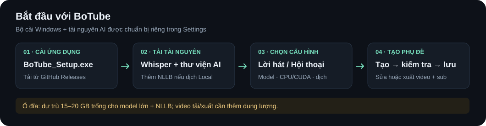

<div align="center">

# BoTube 6.1 · AI Media Player, Hi-Fi Audio Studio & YouTube Online

**Trình phát Nhạc & Video AI thế hệ mới cho Windows — Kết hợp Thư viện Offline, YouTube Online 4K Hi-Fi, Âm thanh 64-bit Float WASAPI Exclusive, Whisper AI CUDA, Karaoke từng chữ, Xuất video GPU NVENC & Két Cookie mã hóa DPAPI**

<p>
  <a href="https://diablo-loc.github.io/App-AI-media-player/"></a>
  <a href="https://github.com/Diablo-Loc/App-AI-media-player/releases/latest/download/BoTube_Setup.exe"></a>
</p>

<p>
  <a href="https://github.com/Diablo-Loc/App-AI-media-player/releases/latest"></a>
  
  
  
  
  
  
</p>

**Tiếng Việt** · [English](README.en.md) · [🌐 Trang giới thiệu BoTube 6.1](https://diablo-loc.github.io/App-AI-media-player/) · [📦 Tải BoTube_Setup.exe](https://github.com/Diablo-Loc/App-AI-media-player/releases/latest/download/BoTube_Setup.exe)

</div>

---

**BoTube 6.1** là ứng dụng nghe nhạc, xem video và tạo phụ đề AI toàn diện cho Windows 10/11 64-bit. Từ thư viện cục bộ đến **YouTube Online Hi-Fi Studio tách biệt hoàn toàn**, BoTube hội tụ bộ xử lý âm thanh **Hi-Fi 64-bit Float + WASAPI Exclusive tự hồi phục**, nhận diện giọng nói **Faster-Whisper CUDA**, dịch lời nhạc đa mô hình **NLLB / Gemini / OpenAI / Claude**, **Karaoke khớp từng chữ kèm phiên âm offline**, **xuất video GPU NVIDIA NVENC** và **cập nhật tự động chuẩn SHA-256** trong một không gian Dark Studio mượt mà, riêng tư tuyệt đối.



---

## Thư viện giao diện thực tế trên BoTube 6.1

<table>
  <tr>
    <td width="50%">
      
      <p align="center"><b>YouTube Online Hi-Fi Studio</b> — Lưới 16:9 mượt mà, tự nạp đề xuất cá nhân từ Két Cookie DPAPI, Viên thuốc &amp; EQ tức thì</p>
    </td>
    <td width="50%">
      
      <p align="center"><b>Trình phát YouTube + AI Sub &amp; Audio-Only</b> — Hi-Fi 64-bit OPUS, Phụ đề AI BoTube tự lưu cache, Chapters &amp; Mix Radio</p>
    </td>
  </tr>
  <tr>
    <td width="50%">
      
      <p align="center"><b>Audio Benchmark Lab</b> — Đo phổ tần số RTA, Đáp tuyến Pha, True-Peak, THD+N &amp; Nghe thử A/B khớp âm lượng</p>
    </td>
    <td width="50%">
      
      <p align="center"><b>Cài đặt Studio &amp; Chế độ Hoạt động</b> — Chuyển đổi Offline / Online / Cả hai, Song ngữ Việt ↔ Anh tức thì</p>
    </td>
  </tr>
</table>

*Toàn bộ ảnh minh họa được chụp trực tiếp từ giao diện PySide6 / Qt6 thật của ứng dụng với danh sách mẫu trung lập; không chứa dữ liệu cá nhân.*

---

## Điểm đột phá trên BoTube 6.1

| Hạng mục | Nâng cấp nổi bật trên BoTube 6.1 |
| --- | --- |
| **YouTube Online Hi-Fi Studio *(Mới 6.1)*** | Xem YouTube 4K/2K/1080p mượt bằng GPU + **âm thanh 64-bit Float WASAPI Exclusive**, chế độ **Chỉ nghe Nhạc**, kết nối luồng **~0.14s**, toàn màn hình sát viền, **Viên thuốc (Dynamic Island)**, **Mini-Player PiP nổi**, Mix Radio và **Đo kiểm Audio Lab** trực tiếp trên luồng YouTube. |
| **Két Cookie mã hóa DPAPI & Tự đồng bộ *(Mới 6.1)*** | Nạp `cookies.txt` 1 lần — BoTube tự mã hóa bằng **Windows DPAPI** gắn chặt tài khoản Windows (`storage/youtube-cookies.vault`), **tự động ghi đè `0x00` xóa sạch file gốc trong Downloads**, tự nạp lại sau khi khởi động lại máy và tự đọc thẳng **Trang chủ, Playlist, Video đã thích, Xem sau & Kênh đăng ký**. |
| **Phụ đề AI BoTube ngay trên YouTube *(Mới 6.1)*** | Tự động tải nền audio gọn nhẹ để chạy Whisper + dịch song ngữ, **lưu cache ổ cứng (< 2 ms khi mở lại)** rồi tự xóa file tạm; hỗ trợ 3 chế độ `Tắt / YouTube CC / ✨ AI BoTube`, tùy chọn chỉ Whisper lời gốc (không gọi dịch), kế thừa trọn bộ giao diện phụ đề BoTube. |
| **3 Chế độ Hoạt động linh hoạt *(Mới 6.1)*** | Chọn **Cả hai (Offline + Online)**, **Chỉ BoTube Offline** hoặc **Chỉ YouTube Online** (tự ẩn tab không liên quan, tối ưu khởi động và giữ nguyên toàn bộ luồng dữ liệu cũ). |
| **Âm thanh Hi-Fi 64-bit & Tự hồi phục WASAPI** | Xử lý 64-bit Float DSP, chuẩn hóa **EBU R128 (−14 LUFS)** chống vỡ đỉnh 0 dBTP, **10-Band & Parametric EQ** chuẩn Squiglink/AutoEQ, **WASAPI Exclusive** cho USB DAC rời, cơ chế **tự nối lại 4 tầng (≤ 0.5s)** chống mất tiếng hay văng app khi tai nghe Bluetooth / DAC chuyển trạng thái, cùng **Audio Lab A/B**. |
| **Karaoke từng chữ & Phiên âm offline** | Chế độ **AMLL Sing** mượt như Apple Music khớp **từng chữ/âm tiết thật** theo giọng hát; tạo dòng phiên âm Latinh (**Romaji, Pinyin, Revised Romanization**) hoàn toàn offline bằng phím tắt `R`. |
| **Xuất Video + Lyric tăng tốc GPU NVIDIA** | Tự động tăng tốc phần cứng **NVIDIA NVENC (`h264_nvenc` ⚡)** khi xuất video kèm phụ đề + hiệu ứng quang học (16:9, 9:16 Shorts, 1:1, 4:5, 21:9, 4K), tự fallback `libx264` CPU mượt mà và giữ nguyên âm thanh gốc. |
| **Cập nhật tự động & Tối ưu tài nguyên** | Nâng cấp trực tiếp qua **GitHub Releases API + Inno Setup 6**, xác thực **SHA-256**, tự đóng mở lại ứng dụng an toàn không cần quyền Admin, tiết kiệm RAM/CPU với cache ảnh thu gọn và HTTP Keep-Alive pool. |

---

## Tính năng toàn diện

- **YouTube Online Hi-Fi Studio (Tách biệt 100% luồng Offline):** khám phá Trang chủ đề xuất cá nhân hóa, Âm nhạc, tìm kiếm có gợi ý, Playlist, Video đã thích, Xem sau, Lịch sử, Kênh đăng ký, Bình luận, Chapters có thể bấm tua, Audio-Only Hi-Fi, PiP nổi, Viên thuốc Dynamic Island và chuyển 1-Click sang trình Tải về.
- **Phát media Offline & Thư viện thông minh:** quét thư mục siêu tốc (`.mp3`, `.mp4`, `.mkv`, `.flac`, `.wav`, `.mov`, `.avi`), tìm kiếm tức thì, trang **For You**, hàng đợi phát, **Bộ sưu tập** (Yêu thích / Playlist tùy biến / Nghe nhiều nhất), **Lịch sử phát (Smart Resume)**, toàn màn hình và **Mini Player (Dynamic Island)**.
- **Âm thanh phòng thu Hi-Fi 64-bit:** ghi nhớ âm lượng phát, chuẩn hóa độ lớn giữa các bài không làm đổi file gốc, các preset tối ưu cho tai nghe & DAC rời, bộ lọc PEQ 64-bit, tự hồi phục thiết bị WASAPI chống ngắt âm và phòng đo phổ **Audio Lab**.
- **Nhận diện lời AI & Lấy lời nhanh:** ưu tiên sub có sẵn (`.lrc`/`.srt`/`.ass`) hoặc lời chuẩn **LRCLIB** căn nhịp giọng hát **< 1 giây**; tự chuyển sang **Faster-Whisper** (`tiny` → `large-v3`, CPU hoặc NVIDIA CUDA) với 2 chế độ **Lời bài hát** và **Hội thoại / Phim**.
- **Dịch thuật AI & Đối soát Genius:** chạy miễn phí hoàn toàn offline bằng **NLLB-200**, hoặc dịch trực tuyến chuẩn văn phong qua **Google Gemini**, **OpenAI (GPT-4o / GPT-5)** và **Anthropic Claude** kèm đối chiếu lời gốc **Genius** có bộ lọc độ tin cậy từng câu.
- **Hiển thị phụ đề, Karaoke & Biên tập:** chọn hiển thị Gốc / Anh / Việt hoặc song ngữ, hiệu ứng **AMLL Sing**, phi tiêu, sao, cánh hoa, typography 60 FPS, **🎤 Chế độ Karaoke** khớp từng chữ, phiên âm trên cùng (`Phiên âm (R)`), cùng trình chỉnh sửa phụ đề hỗ trợ nhập/xuất `JSON`, `SRT`, `ASS`, `LRC`.
- **Xuất video kèm phụ đề:** chọn tỉ lệ nguồn, `16:9`, `9:16`, `1:1`, `4:5`, `21:9`, độ phân giải lên tới 4K, FPS, vùng an toàn chống cắt chữ và mã hóa ưu tiên GPU **NVENC**.
- **Tải video & nhạc chất lượng gốc:** tích hợp `yt-dlp` giữ nguyên chất lượng nguồn âm thanh AAC/Opus hoặc MP3 320 kbps, hỗ trợ nối tải dở dang và tải tự động tên video.

---

## Cài đặt & Nâng cấp (An toàn 100% từ 5.0 / 6.0 lên 6.1)

### Cài mới hoặc nâng cấp bằng `BoTube_Setup.exe`

**[🌐 Mở trang giới thiệu BoTube 6.1](https://diablo-loc.github.io/App-AI-media-player/)** · **[⬇️ Tải BoTube_Setup.exe](https://github.com/Diablo-Loc/App-AI-media-player/releases/latest/download/BoTube_Setup.exe)** · **[📋 Tất cả bản phát hành](https://github.com/Diablo-Loc/App-AI-media-player/releases)**

1. Tải **`BoTube_Setup.exe`** từ trang [Releases](https://github.com/Diablo-Loc/App-AI-media-player/releases/latest) và chạy trình cài đặt Windows.
   - **Nếu máy đang cài BoTube 5.0 / 6.0:** bộ cài giữ nguyên `AppId`, tự nâng cấp đè đúng thư mục cũ, tự dọn file runtime thừa và **giữ nguyên 100% thư viện, playlist, phụ đề (`storage/`) và toàn bộ mô hình AI (`app_resources/`)**.
2. Mở BoTube từ shortcut vừa tạo. Nghe nhạc Hi-Fi, xem **YouTube Online Studio**, tải video và xem phụ đề có sẵn hoạt động ngay lập tức.
3. **Trước lần tạo phụ đề AI đầu tiên**, mở **Cài đặt → Tải / Cập nhật mô hình & thư viện AI** để chọn model Whisper (khuyên dùng `large-v3` nếu có GPU NVIDIA) và bấm **Bắt đầu cài đặt tự động**.
4. Nếu muốn dịch hoàn toàn ngoại tuyến (hoặc làm dự phòng khi API lỗi), chọn tải kèm **NLLB-200 Offline**.
5. Chọn thiết bị tính toán (`CUDA` hoặc `CPU`), **Chế độ hoạt động** (`Cả hai / Offline / Online`), **Loại nội dung** và dịch vụ dịch thuật trong **Cài đặt** (tự động lưu tức thì).



### Cơ chế cập nhật tự động (từ bản 6.0.0 trở đi)

BoTube tích hợp bộ cập nhật trực tiếp từ **GitHub Releases**:
- Tự động kiểm tra bản phát hành mới tối đa 1 lần/ngày khi khởi động (có thể bật/tắt hoặc kiểm tra thủ công bất cứ lúc nào trong **Cài đặt → Cập nhật ứng dụng**).
- Tải `BoTube_Setup.exe` từ nguồn HTTPS chính thức của GitHub, kiểm tra định dạng thực thi (`MZ`) và **xác thực mã băm SHA-256** trước khi cài đặt.
- Tự gọi Inno Setup ở chế độ nâng cấp gọn nhẹ (`/SILENT /CLOSEAPPLICATIONS`), đóng app an toàn, cài đè sạch sẽ và tự mở lại BoTube ở quyền người dùng thường.
- Dữ liệu cá nhân (`storage/`) và kho model AI (`app_resources/`) luôn được bảo toàn nguyên vẹn.

### Lưu ý dung lượng ổ đĩa

- Bộ cài `BoTube_Setup.exe` gọn nhẹ (chỉ gồm ứng dụng, runtime và FFmpeg/yt-dlp).
- Nếu tải thêm model Whisper lớn (`large-v3`), bộ dịch offline `NLLB-200` và thư viện PyTorch/CUDA vào `app_resources/`, nên dự trù khoảng **15–20 GB dung lượng trống**.
- Cache âm thanh xử lý (`storage/audio-playback-cache/`) có ngân sách mặc định khoảng **1 GiB**.

### Chọn loại nội dung AI

| Chế độ | Phù hợp | Cách xử lý |
| --- | --- | --- |
| **Lời bài hát** · mặc định | Nhạc, MV, lyric video | Lọc intro/credit, nhóm câu theo nhịp, căn chữ Karaoke và dịch theo văn phong lời bài hát (hỗ trợ đối soát Genius). |
| **Hội thoại / Phim** | Video, phim, podcast | Chia câu theo từ, dấu câu và khoảng nghỉ tự nhiên; bỏ qua bộ lọc nhạc/Genius và dịch theo văn phong hội thoại. |

---

## Phím tắt trình phát

| Phím | Thao tác |
| --- | --- |
| `Space` | Phát / Tạm dừng |
| `F` | Bật / Tắt toàn màn hình |
| `Esc` | Thoát chế độ toàn màn hình |
| `←` / `→` | Tua lùi / tiến 10 giây |
| `↑` / `↓` | Tăng / Giảm âm lượng |
| `R` | Bật / Tắt nhanh dòng **Phiên âm (Romaji / Pinyin / Hàn)** khi đang xem video |

---

## Chạy từ mã nguồn & Đóng gói bản phát hành

Môi trường mục tiêu: **Windows 10/11 64-bit, Python 3.11**. Đặt `ffmpeg.exe` và `ffprobe.exe` trong `bin/` ở gốc dự án (hoặc `app_resources/bin/` / PATH).

### 1. Chạy từ mã nguồn

```powershell
py -3.11 -m venv venv
.\venv\Scripts\python.exe -m pip install -r requirements.txt
.\venv\Scripts\python.exe app/run_app.py
```

### 2. Đóng gói bản Portable & Bộ cài `BoTube_Setup.exe` (1 lệnh)

Yêu cầu đã cài `PyInstaller` (`pip install -r requirements-build.txt`) và **Inno Setup 6**:

```powershell
# Đóng gói PyInstaller portable -> tự biên dịch Inno Setup 6 -> xuất BoTube_Setup.exe & .sha256
.\packaging\build_release_installer.ps1 -BuildPortable
```

- Lệnh trên đọc phiên bản duy nhất từ `app/version.py` (`6.1.0`), chạy `build_app.py` (không ghi đè bản build cũ trong `dist/`), biên dịch `packaging/BoTube_Setup.iss` và xuất sẵn `Installer\BoTube_Setup.exe` kèm `Installer\BoTube_Setup.exe.sha256`.
- Nếu chỉ muốn kiểm tra cấu hình build mà không đóng gói: `.\venv\Scripts\python.exe build_app.py --dry-run`.

### 3. Cấu trúc dữ liệu người dùng

```text
BoTube/
├── BoTube.exe                    # Tệp thực thi chính
├── _internal/                    # Runtime PyInstaller (tự làm sạch khi nâng cấp)
├── bin/                          # FFmpeg, FFprobe
├── icon/ & resources/            # Biểu tượng ứng dụng
├── app_resources/                # Thư viện AI portable, Whisper & NLLB models (bảo toàn 100%)
└── storage/                      # Thư viện, playlist, phụ đề, Két Cookie DPAPI & cache (bảo toàn 100%)
```

---

## Kiểm thử & Phát triển

Mã nguồn ứng dụng nằm trong `app/` (`core/`, `ui/`, `control/`, `ai/`, `pipeline/`, `translate/`, `subtitle/`, `download_core/`).

```powershell
$env:PYTHONPATH=".;app"; $env:KMP_DUPLICATE_LIB_OK="TRUE"; $env:QT_QPA_PLATFORM="offscreen"
.\venv\Scripts\python.exe -m unittest `
  tests.test_youtube_online `
  tests.test_hifi_audio_engine `
  tests.test_app_updater `
  tests.test_ui_settings_and_i18n `
  tests.test_app_optimization `
  tests.test_hardware_media_controls `
  tests.test_subtitle_studio `
  tests.test_nvenc_video_export `
  tests.test_word_karaoke_and_phonetics `
  tests.test_playlists_favorites_history `
  tests.test_download_studio -v
```

Xem thêm [tài liệu dự án](docs/README.md), [hợp đồng tính năng](docs/FEATURE_PARITY.md), [hướng dẫn kiểm thử](tests/README.md) và [quy tắc phát triển](AGENTS.md).

## Giới hạn hiện tại

- Nhận diện giọng nói AI có thể lệch từ hoặc mốc thời gian khi hát quá nhanh, nhạc nền rất lớn hoặc nhiều giọng chồng nhau — nên xem lại bằng trình sửa phụ đề trước khi xuất bản.
- Dịch Online, phát trực tuyến YouTube và tải nội dung phụ thuộc mạng, giới hạn API và chính sách dịch vụ bên thứ ba; hãy giữ bí mật API key và tệp cookie cục bộ trên máy.
- Bộ preset âm thanh tối ưu hóa độ sạch, độ cân bằng và loại bỏ clip kỹ thuật số, không thể tái tạo chi tiết gốc đã bị mất do file nguồn nén chất lượng thấp.

## Giấy phép & Tài nguyên bên thứ ba

- Biểu tượng Lucide đi kèm theo [ISC License](app/ui/assets/icons/LICENSE).
- Model dịch cục bộ [NLLB-200 distilled 600M](https://huggingface.co/facebook/nllb-200-distilled-600M) phát hành theo giấy phép phi lợi nhuận **CC-BY-NC-4.0**.
- Các thư viện, FFmpeg, yt-dlp và model AI tuân theo giấy phép riêng của từng dự án gốc.
